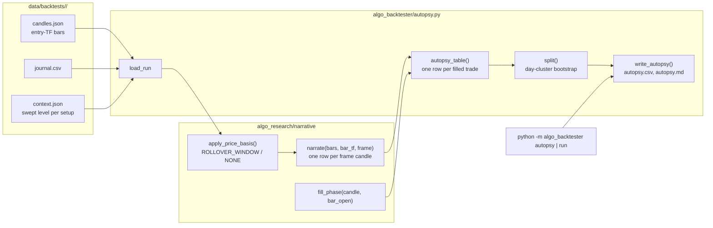

# Design Document

**Spec**: Market Narrative
**Requirements**: `.kiro/specs/market-narrative/requirements.md`

## Overview

Stage 1 builds two pieces:
- **A narrative library** describes finished candles at any frame (`algo_research/narrative/`).
- **An autopsy** labels a backtest run's trades with those narratives and splits the run's R by failure mode (`algo_backtester/autopsy.py`).

Design choices:
1. **The run directory is the only input.** `journal.csv`, `context.json` and `candles.json` already hold the trades, the swept level behind each setup, and the entry-timeframe candles over the whole span of the run's orders. So the autopsy works on old runs, needs no Docker, and costs seconds.
2. **One narrative definition, any frame.** `narrate()` reads bars and the strategy calendar, never a timeframe constant. The autopsy calls it for W1, D1 and H4. AlgoResearch's any-frame labels (context-engine task 281) and stage 2 reuse it.
3. **The price basis is an input, not a hidden step.** The run's candles carry no spread, so stage 1 flattens a time window after 17:00 New York (ND-D7). The spread-based quarantine of context-engine task 276 plugs into the same parameter when it exists.
4. **Hindsight stays in its box.** The narrative package sits beside `labels.py`. The import guard is extended to it, and the only as-of column (the shape so far) reads bars closed before the fill, tested as a truncation property.
5. **The split reuses AlgoResearch's statistics.** Intervals come from `algo_research.stats.Bootstrap`, resampling trading dates, as every other interval in the project does.

### Changes to existing code

| # | Change | Why |
|---|---|---|
| C1 | `algo_research/narrative/` (new): `config.py`, `prices.py`, `candles.py` | Requirements 1, 2 |
| C2 | `algo_backtester/autopsy.py` (new) | Requirements 3, 4 |
| C3 | `algo_backtester/cli.py`: the `autopsy` command; `run` writes the autopsy after the report | Requirements 4.3, 4.4 |
| C4 | `config/research/narrative.toml` (new): frames, bias frame, direction rule, price basis | Requirement 1.5, 2.1; trading-method.md rule 4 (proposed definitions are settings) |
| C5 | `backend/tests/test_research_labels.py`: the guard covers `algo_research.narrative` and `algo_backtester.autopsy`, and `liquidity_engine/` and `agent/` | Requirement 5.1 |

Nothing in `liquidity_engine/`, `agent/` or Phase A changes, so no run's journal moves.

---

## Architecture



---

## Components and Interfaces

### `algo_research/narrative/config.py`

```python
@dataclass(frozen=True)
class PriceBasis:
    rule: str = "ROLLOVER_WINDOW"                    # NONE | ROLLOVER_WINDOW (ND-D7)
    minutes: int = 30                                # 1..60, after 17:00 New York
    instruments: tuple[str, ...] = ("EURUSD", "GBPUSD", "USDJPY")
    closure_minutes: int = 60                        # a longer gap before a window bar is a closure

@dataclass(frozen=True)
class NarrativeConfig:
    frames: tuple[Timeframe, ...] = (Timeframe.W1, Timeframe.D1, Timeframe.H4)   # ND-D10
    bias_frame: Timeframe = Timeframe.D1
    direction_rule: str = "CLOSE_VS_OPEN"            # ND-D6; the only rule in stage 1
    price_basis: PriceBasis = PriceBasis()
    resamples: int = 2000                            # the split's bootstrap

def load_narrative_config(path: Optional[Path] = None) -> NarrativeConfig
```

- With no path, it reads `config/research/narrative.toml` when present, else the defaults.
- Unknown keys, an unknown rule, a bias frame outside the frames, or minutes outside 1–60 raise `ValueError` naming the key.

### `algo_research/narrative/prices.py`

`apply_price_basis(bars, instrument, basis) -> DataFrame` takes columns `time` (UTC), `open`, `high`, `low` and `close`, and returns a copy:
- **`NONE`:** the bars unchanged.
- **`ROLLOVER_WINDOW`, configured instrument:**
  - a bar whose New York opening time falls in [17:00, 17:00 + minutes) gets open, high, low and close set to one price;
  - that price is the last clean close when the last clean bar is within `closure_minutes` (CE-D3's "as if the market had paused");
  - after a longer gap (the weekly reopen) or at the start of a series, it is the open of the first clean bar after the window, so a real gap such as the NWOG survives;
  - window bars with no clean bar after them are dropped.
- **Any other instrument:** unchanged.

### `algo_research/narrative/candles.py`

```python
CHILD = {Timeframe.MN1: Timeframe.W1, Timeframe.W1: Timeframe.D1, Timeframe.D1: Timeframe.H4,
         Timeframe.H4: Timeframe.H1, Timeframe.H1: Timeframe.M15}
NARRATIVE_COLUMNS = ("start", "end", "open", "high", "low", "close", "range", "t_high", "t_low",
                     "direction", "false_price", "t_false", "exp_price", "t_exp", "inverted",
                     "false_move", "false_share", "high_child", "low_child", "complete")

def narrate(bars: DataFrame, bar_tf: Timeframe, frame: Timeframe,
            calendar: StrategyCalendar = StrategyCalendar()) -> DataFrame
def fill_phase(candle: Mapping, bar_open: Timestamp) -> str
```

- **`narrate`:**
  - It refuses (`ValueError`) a `bar_tf` that isn't finer than `frame`.
  - Each bar's frame period comes from `calendar.period_start`, cached per opening hour for frames of H1 and up.
  - Per period:
    - open is the first bar's open and close the last bar's close;
    - `t_high` and `t_low` are the opening times of the first bars at the extremes (`idxmax`/`idxmin` keep the first);
    - direction follows ND-D6;
    - the false-move and expansion fields follow the glossary; FLAT candles get NaN and NaT;
    - `inverted` is `t_exp < t_false`.
  - **Child index:** count the child periods from the frame's start, stepping with `calendar.period_end`, until the child period holding the extreme. This is calendar-based, so a child with no bars still counts. D1 by H4: 0 is the 17:00 New York slot and 4 the 09:00 one. W1 by D1: the week starts at the server's Sunday (17:00 New York on Saturday), so 0 is Sunday's empty D1, 1 is Monday (from Sunday 17:00 New York) and 5 is Friday.
  - **`complete`** is false for the candle holding the series' first bar unless that bar opens at the candle's start, and for the candle holding the last bar unless that bar ends at the candle's end.
- **`fill_phase`:** Requirement 3.2: UNKNOWN first (a missing, incomplete or FLAT candle), then INVERTED, then by the bar's time against the two extremes.

### `algo_backtester/autopsy.py`

```python
FAILURE_MODES = ("WITH_ON_TIME", "WITH_EARLY", "WITH_LATE", "WITH_INVERTED",
                 "AGAINST_EXPANSION", "AGAINST_OTHER", "UNKNOWN")

@dataclass(frozen=True)
class RunInputs:
    run_id: str
    journal: DataFrame            # filled, closed trades
    open_at_end: int
    contexts: dict[str, dict]     # setup_id -> recorded context
    bar_tf: Timeframe
    bars: dict[str, DataFrame]    # instrument -> entry-TF bars

class AutopsyError(Exception): ...

def load_run(run_dir: Path) -> RunInputs
def autopsy_table(inputs: RunInputs, cfg: NarrativeConfig) -> DataFrame
def split(table: DataFrame, by: str, seed: int, resamples: int) -> DataFrame
def autopsy_md(table: DataFrame, inputs: RunInputs, cfg: NarrativeConfig) -> str
def write_autopsy(run_dir: Path, cfg: Optional[NarrativeConfig] = None) -> tuple[Path, Path]
```

**`load_run`:**
- raises `AutopsyError` when a file is missing;
- keeps journal rows with a fill, a close and an exit reason other than `OPEN_AT_END`, and counts the `OPEN_AT_END` ones.

**`autopsy_table`:**
1. Per instrument:
   - apply the price basis;
   - `narrate` each frame;
   - index each narrative by `start`.
2. Per trade:
   - `fill_bar` = the fill time floored to `bar_tf` on the calendar;
   - for each frame:
     - the candle is the narrative row at `calendar.period_start(fill_time, frame)`;
     - `<tf>_dir` is the candle's direction, or `UNKNOWN` when the candle is missing or incomplete;
     - `<tf>_with` is true, false, or empty when unknown.
3. For the bias frame:
   - `phase = fill_phase(candle, fill_bar)`, then the columns of Requirement 3.3;
   - the raid columns read `context.swept_level.price` and `raided_at`, and stay empty when the setup recorded none;
   - the as-of shape reads the bias candle's bars with `time + bar_tf <= fill_time`.
4. `mode` follows Requirement 3.4.
5. `trading_date` is the D1 candle's trading date (`period_start(fill, D1) + 7 h`, the calendar's ny_close date), so the bootstrap clusters the way AlgoResearch does.

**`split`:**
- groups by `by`;
- builds `series_table(trading_date, instrument, {"r": (net_r, 1)})` per group;
- takes `Bootstrap(table, resamples, seed)` and reads the 2.5th and 97.5th percentiles of `ratios("r")`;
- returns rows in a fixed order: failure modes in `FAILURE_MODES` order, other columns sorted.

The seed is `seed_from(sha256(run_id))`.

**`autopsy_md`:**
- plain Markdown tables;
- every float at fixed precision;
- no timestamps of its own, so the file is byte-identical across reruns (Requirement 3.6).

**`write_autopsy`:**
- writes `autopsy.csv` (`lineterminator="\n"`, floats at 6 decimals) and `autopsy.md`;
- returns their paths.

### CLI

- **`python -m algo_backtester autopsy <run_dir> [--config <toml>]`:**
  - exit 0 when written;
  - exit 2 when `AutopsyError` is raised (a directory without the run files, or candles not finer than a frame).
- **`run`:** after `write_html_report`, calls `write_autopsy(run_dir)`.
  - It prints the path.
  - On `AutopsyError` it prints `autopsy skipped: <reason>` and still exits 0, since the run itself succeeded.

---

## Data Models

`autopsy.csv` columns, in order:

| Column | Meaning |
|---|---|
| `t`, `instrument`, `setup_id`, `direction`, `entry`, `stop`, `target`, `filled_at`, `exit_reason`, `net_r`, `mfe_r` | from the journal |
| `trading_date` | the fill's D1 trading date |
| `ny_hour` | New York hour of the fill |
| `W1_dir`, `W1_with`, `D1_dir`, `D1_with`, `H4_dir`, `H4_with` | one pair per configured frame |
| `bias_start`, `phase` | the bias candle and the fill phase |
| `stopped_by_false_move`, `target_beyond_expansion` | Requirement 3.3; empty unless with the candle |
| `raid_beyond_open`, `raid_in_candle`, `raid_tf`, `raid_source` | Requirement 3.3; empty without a recorded raid |
| `fill_side` | `FAVOURABLE` or `UNFAVOURABLE` |
| `asof_shape` | `WITH_SHAPE`, `FADES_SHAPE` or `UNFORMED` |
| `mode` | the failure mode |

---

## Correctness Properties

### Property 1: Resolution Invariance
*For any* bar series and frame F, narrating F from the bars, or from those bars aggregated on the strategy calendar to any coarser timeframe that is still finer than F, gives the same open, high, low, close, direction and child indexes. `t_high` and `t_low` from the coarser bars equal the finer ones floored to the coarser timeframe, and the inversion agrees whenever the two extremes fall in different coarser bars.

**Validates: Requirements 1.1, 1.3**

### Property 2: Locality
*For any* bar series under price basis `NONE`, changing the bars outside a candle leaves that candle's narrative unchanged. Under `ROLLOVER_WINDOW`, the candle also reads the last kept close before it, and nothing else outside it.

**Validates: Requirements 1.4, 2.1**

### Property 3: The Split Adds Up
*For any* autopsy table, the sums of net R over the failure modes equal the table's total net R, and the counts equal its length.

**Validates: Requirements 3.5**

### Property 4: As-Of Shape Truncation
*For any* trade, changing every bar that closes after its fill time leaves its `asof_shape` unchanged.

**Validates: Requirements 3.3, 5.2**

---

## Testing Strategy

- `backend/tests/test_narrative.py`:
  - unit cases (an up day with a low-first shape, a down day, an inverted day, a flat day, ties, incomplete edges, the W1 child index across Sunday's hour);
  - the price basis (window flattening, the leading drop, gold untouched, DST on both sides);
  - config validation;
  - Properties 1 and 2 with `hypothesis`;
  - the extended import guard.
- `backend/tests/test_backtest_autopsy.py`:
  - a synthetic run directory with one trade per failure mode and known answers for every column;
  - the open-at-end count;
  - empty runs;
  - refusals;
  - byte-identical rewrites;
  - Properties 3 and 4.
- `backend/tests/test_backtest_cli.py`: the run directory now lists `autopsy.csv` and `autopsy.md`; the `autopsy` command writes them, and refuses a non-run directory with exit 2.

---

## Error Handling

| Situation | Behaviour |
|---|---|
| Run directory without `journal.csv`, `context.json` or `candles.json` | `AutopsyError`; the CLI exits 2 naming the file |
| Recorded candles not finer than a frame | `AutopsyError` naming the frame; `run` prints "autopsy skipped" |
| A trade's candle missing (outside the recorded span) or incomplete | Its frame columns are `UNKNOWN` and empty; its mode is `UNKNOWN` |
| No filled trades | The files are written, and `autopsy.md` says there were none |
| Bad `narrative.toml` | `ValueError` naming the key |

---

## Update 2026-10-14: The Blind Replay (Requirement 10)

A local page, served by the standard library's HTTP server on 127.0.0.1, so the trader's reads stay on the machine. No new Python dependencies; the page loads TradingView's open-source Lightweight Charts 4.2.0 from unpkg, pinned.

    python -m algo_research.replay [--instrument XAUUSD] [--port 8765] [--no-browser]

Package `algo_research/replay/`:

| Module | Role |
|---|---|
| `bars.py` | `ReplayBars`: the snapshot's M1 for one instrument, with the narrative's price basis (ND-D7), pre-aggregated to W1…M5 on the strategy calendar (`aggregate_frame`). `as_of(tf, until)` returns the closed bars plus the forming bar built from the M1 bars closed by `until`. |
| `journal.py` | `Journal`: the day records and their rules. A day moves `READING` → `INTRADAY` (read saved) → `REVEALED`; `revealed_until` only moves forward and never passes the D1 close; every write is refused in the wrong state (`ReplayError`). `day_order` is the explore slice's trading dates with M1, shuffled with a fixed seed. Files are written to a temporary name and renamed. |
| `scoring.py` | `score_thesis`, `score_trade` (Requirement 10.7) on M1 rows; `summarize` (10.9), bootstrapping over trading dates. |
| `server.py` | `ReplayApp` (the API as plain methods, tested without HTTP) and a thin `BaseHTTPRequestHandler`. |
| `static/index.html` | The page: timeframe buttons, the chart, the read form (a click on the chart fills the focused price field), the step buttons, the trade form, the reveal and the summary. Times are New York wall time; the axis shows weekday and time only until the reveal. |

API (JSON; the current day is the journal's next day):

| Method | Path | Does |
|---|---|---|
| GET | `/api/state` | the day: weekday, status, revealed time, open price, read, trades; the date only once revealed or shown |
| GET | `/api/bars?tf=H1` | `as_of(tf, revealed_until)` |
| POST | `/api/read` | saves the read (10.3) |
| POST | `/api/advance` | `{"step": "M5"}` or `{"to": "09:30"}` |
| POST | `/api/trade` | marks a trade at the revealed time (10.5) |
| POST | `/api/reveal` | ends the day: narrative and scores (10.6, 10.7) |
| POST | `/api/show-date` | records that the date was shown (10.1) |
| POST | `/api/next` | moves to the next day |
| GET | `/api/summary` | 10.9 |

A refused write answers 409 with the reason; an unknown timeframe or a malformed body, 400.

The replay imports the narrative for the reveal. It decides nothing, so Requirement 5's guard doesn't apply to it.

---

## Update 2026-10-14b: The Replay Chart (Requirement 11)

| Module | Change |
|---|---|
| `timeframes.py` (new) | The chart's timeframes and their bucketing, in New York wall-clock seconds: `bucket(wall, tf)` counts intraday bars from the 17:00 open; W1 from Sunday 17:00; MN1 by trading date. `aggregate` is vectorised (`reduceat`). |
| `bars.py` | `as_of(tf, until, since=None)` aggregates on request from the M1 bars closed by `until` (bar times in wall seconds); `since` returns only the bars from the one holding it, for live updates. `next_open` finds the reopen after a pause. |
| `journal.py` | `STEPS` adds M30 and H4; a step into a pause lands past the reopen. `save_drawings` checks and stamps drawings (`DRAWING_POINTS`, at most 400); `save_read` and `reveal` keep copies; `save_narrative`; `live_trades`; a trade may carry its drawing's id. |
| `server.py` | `GET /api/meta` (timeframes, steps); `/api/bars?tf=&since=`; `POST /api/advance` with `tf` and `since` answers with `update` (the chart's new bars and the M1 bars revealed); `POST /api/drawings`, `POST /api/narrative`; serves `static/app.js`, `drawings.js`, `app.css` by name only. Market times that would name the date are left out of the page's drawings. |
| `static/drawings.js` (new) | One series primitive (Lightweight Charts 4.2 plugins) paints every drawing; times map to logical positions through the bars on screen, so drawings sit right on every timeframe. Pointer: create by clicks, select, drag handles or the body, magnet. |
| `static/app.js`, `app.css` | Timeframe bar, play/pause and speeds, jumps, the tool strip, the read form (prices picked from the chart; "from box" fills the key array), the settings of the selected drawing (place a position as a trade), the live trades, the narrative. |

The page was driven end to end in headless Chrome (puppeteer, scratchpad): every tool drawn, labelled, dragged and undone; the read saved with its drawings; the day played and jumped; a position placed and followed to its stop; all twenty timeframes loaded; the reveal, the narrative and the next day; no console errors.
